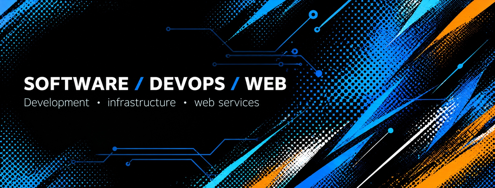

I work with existing codebases: reviewing code, refactoring complex parts,
fixing edge cases, and making software easier to maintain. I enjoy taking a
working idea and improving its structure, reliability, and everyday usability.

My stack includes C#, C++, C, Python, Rust, and JavaScript, with HTML and CSS
for web projects. I like practical engineering, clear interfaces, and changes
that make a project easier to understand and build on.

Alongside development, I work with industrial software and hardware integration,
automation interfaces such as UART, RS-485, and 4–20 mA, as well as server
infrastructure, websites, and monitoring tools. Connecting these areas and
keeping systems useful over time is a big part of what I do.

